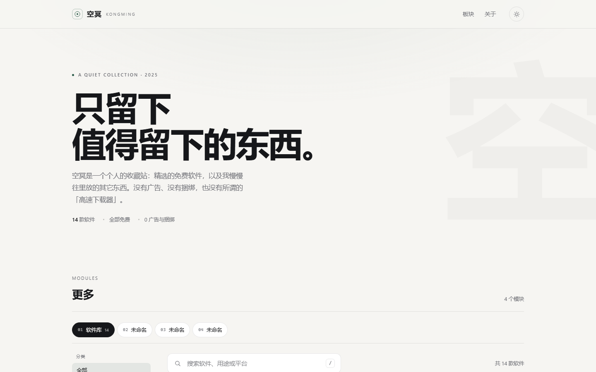
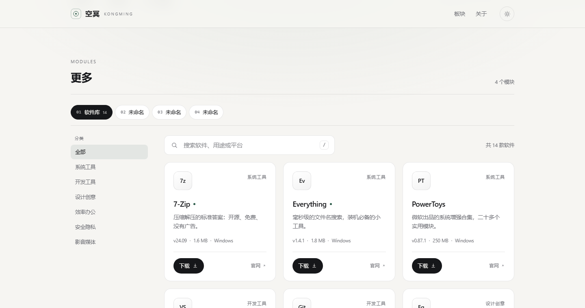

# 空冥 · KONGMING

一个极简风格的个人收藏站模板：纸感底色、发丝分隔线、留白与一个克制的墨绿重音。
上半部分是软件下载库，下面留了三个「空位」，想放什么就放什么。
纯静态，无框架、无构建步骤、无外部依赖，改两个文件就能变成你自己的站。



## 本地预览

直接双击 `index.html` 即可；更推荐起一个本地服务器（避免个别浏览器的本地文件限制）：

```powershell
# 任选一种
python -m http.server 8000
npx serve .
```

然后打开 <http://127.0.0.1:8000>。

## 文件结构

```
kongming/
├─ index.html          页面结构（导航、首屏、模块条、分类栏、三条规矩、页脚）
├─ assets/
│  ├─ style.css        全部样式与响应式规则
│  └─ main.js          软件数据 + 搜索/筛选/主题切换
├─ preview/            预览截图
└─ README.md
```

## 想改哪里

### 1. 站点名与文案

在 `index.html` 里搜索「空冥」替换成你的名字；首屏大标题、副标题、三条规矩、页脚免责声明都是普通文字，直接改。

### 2. 添加 / 删除软件

打开 `assets/main.js`，顶部的 `SOFTWARE` 数组就是全部内容。复制一条改掉字段即可：

```js
{
  name: "7-Zip",                    // 软件名
  mark: "7z",                       // 卡片左上角标记（2–3 个字符）
  cat: "系统工具",                   // 分类中文名
  catKey: "system",                 // 分类标识，要和筛选按钮的 data-cat 对应
  tagline: "一句话介绍。",
  version: "24.09",
  size: "1.6 MB",
  platform: "Windows",
  download: "https://…/download",   // 官方下载页
  site: "https://…",                // 官网
  pick: true                        // 是否显示「编辑精选」小圆点
}
```

新增分类时，在 `index.html` 的 `.filters` 里加一个按钮：

```html
<button class="chip" type="button" data-cat="audio" aria-pressed="false">音频工具</button>
```

### 3. 模块与分类

「更多」区分成两层：上面一排是模块（大模块），左边一列是当前模块的分类（小模块），右边是内容。模块再多也只占一行，不会和分类挤在一起。



```html
<!-- 第一层：模块 -->
<div class="module-bar" role="tablist">
  <button class="tab is-active" data-panel="panel-software">
    <span class="tab-index">01</span>
    <span class="tab-name">软件库</span>
    <span class="tab-meta">14</span>
  </button>
</div>

<!-- 第二层：分类 + 内容 -->
<div class="hub-layout">
  <aside class="rail" id="rail">
    <div class="rail-filters">
      <button class="chip is-active" data-cat="all">全部</button>
      <button class="chip" data-cat="system">系统工具</button>
    </div>
  </aside>
  <div class="panels">…</div>
</div>
```

- **改模块名**：改按钮里的 `.tab-name`；右边的 `.tab-meta` 可以写数量，不写就删掉。
- **加模块**：复制一个 `.tab` 和一个 `.panel`，保证按钮的 `data-panel` 与面板的 `id` 一致，面板记得带 `hidden`。模块超过一行时，模块条会横向滚动，不会换行。
- **放内容**：空位模块的正文在 `.slot-title` / `.slot-hint` 里，直接换成你自己的文字或 HTML。
- **加分类**：复制一个 `.chip`，`data-cat` 要和 `assets/main.js` 里每条软件的 `catKey` 对上（`system` / `dev` / `design` / `office` / `security` / `media`），筛选会自动生效。
- **分类栏的显隐**：只有软件库有分类；切到空位模块时整列自动收起，内容区自动变宽，由 `selectTab()` 里的 `rail.hidden` 控制。
- **桌面端**：分类栏会跟着页面滚动固定（`position: sticky`），看长列表时分类一直在。
- **手机端**：模块条横向滚动，分类变成一排横向按钮。

### 4. 配色

`assets/style.css` 顶部是全部设计变量，改这几行就能换掉整体气质：

```css
:root {
  --paper: #f6f5f2;     /* 页面底色 */
  --surface: #ffffff;   /* 卡片底色 */
  --ink: #16171a;       /* 主文字 / 深色按钮 */
  --accent: #2c5b49;    /* 重音色：墨绿 */
  --line: rgba(22,23,26,.1);
}
```

深色主题在 `[data-theme="dark"]` 里单独定义，两套都改才完整。

### 5. 字体

用的是系统字体栈，不加载网络字体，所以打开就能用、不会闪。想换字体只改 `--font-sans`。

## 部署上线

站点是纯静态的，任选一个平台。

**建议第一次就用 Vercel**：不用填构建命令，导入仓库点一下 Deploy 就完事，之后换域名也不用改代码。默认的 `xxx.vercel.app` 在国内有时打不开，想稳一点就绑一个自己的域名（约 60–100 元/年）。

> 小提示：Cloudflare 新账号要手机验证，国内号码有时会被临时屏蔽（提示「请等待 12 小时再试」）。遇到这种情况不用干等，换 Vercel 或 GitHub Pages 就行 —— 它们用 GitHub 账号登录，不需要手机号。

### Vercel（推荐，最快）

1. 注册 <https://vercel.com>，装一个 GitHub 账号。
2. 把 `kongming` 文件夹推到 GitHub 仓库。
3. Vercel → Add New → Project → 选中仓库 → Framework 选 **Other** → Deploy。
4. 一两分钟后拿到 `xxx.vercel.app` 域名。

### Cloudflare Pages

1. <https://pages.cloudflare.com> → Create a project → 连接仓库。
2. Build command 留空，Output directory 填 `/`（如果没有构建）。
3. 部署完成得到 `xxx.pages.dev`。

### GitHub Pages

1. 仓库 → Settings → Pages → Source 选 `Deploy from a branch`。
2. Branch 选 `main`、目录选 `/ (root)`，保存。
3. 等一分钟，访问 `https://你的用户名.github.io/仓库名/`。

### 绑定自己的域名

1. 在域名商（阿里云、腾讯云、Namecheap、Cloudflare）买域名并完成实名。
2. 在托管平台的 Domains 里添加域名，按提示在域名商处加一条 `CNAME` 记录。
3. 等 DNS 生效（几分钟到几小时），平台会自动签发 HTTPS 证书。

> 服务器放在中国大陆境内需要 ICP 备案（约 1–3 周）；用 Vercel / Cloudflare / GitHub Pages 这类境外托管不需要备案，但国内访问速度一般。

## 上线前检查

- [ ] 把 `SOFTWARE` 里所有 `download` / `site` 链接换成真实官方地址
- [ ] 页脚的免责声明保留（本站不托管安装包，跳转官方源）
- [ ] 手机宽度 375px 左右打开一遍，确认没有横向滚动
- [ ] 确认全站 https（托管平台默认开启）
- [ ] 在 `index.html` 里补上你的统计代码（如需要）

## 说明

- 本模板不托管任何安装包，所有下载均跳转开发者官方网站，演示数据中的链接均为各软件官网。
- 站点默认跟随系统的明暗偏好，右上角按钮可手动切换，选择会记在浏览器里。
- `assets/main.js` 里的下载链接是可点的外链，正式运营前请确认目标地址仍然有效。
